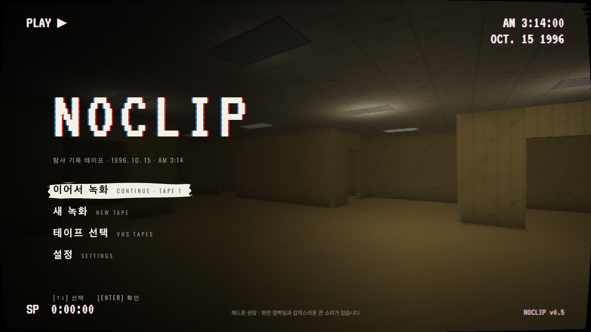
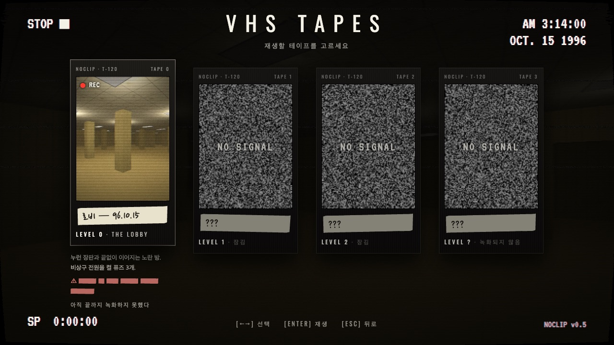
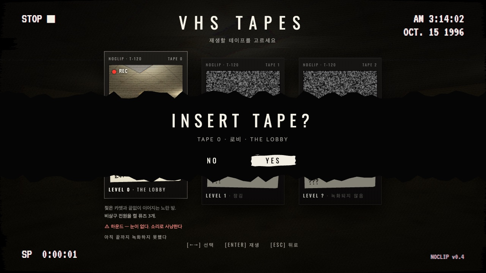
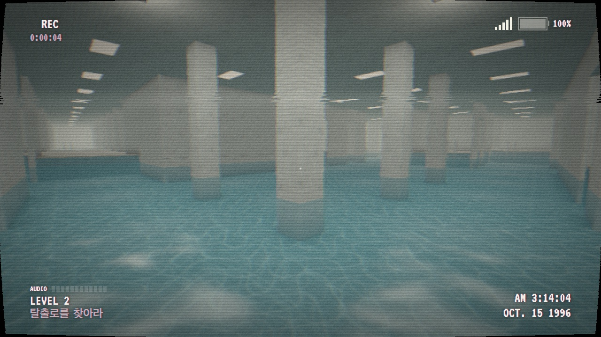
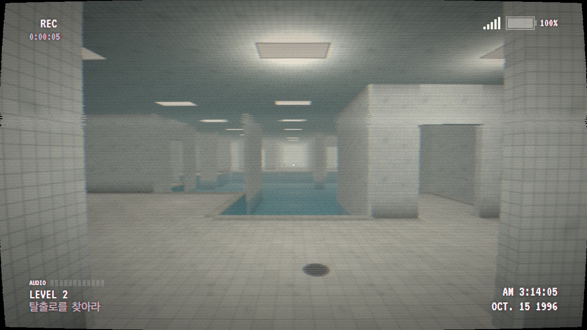

# NOCLIP

> 1996년 10월 15일 새벽 3시 14분. 녹화 버튼은 아직 눌려 있다.

### [▶ 브라우저에서 바로 플레이](https://noclip-swart.vercel.app)

설치 없이 바로 실행됩니다 · 데스크톱 브라우저 · 마우스와 키보드 · 헤드폰 권장

---

폐교된 학교 지하를 조사하던 촬영팀이 남긴 마지막 테이프.
보일러실 벽에 손을 짚은 순간 벽은 사라졌고, 그 너머에는 끝없이 이어지는 노란 방이 있었다.

**NOCLIP**은 백룸(The Backrooms)을 헤매는 1인칭 파운드 푸티지 공포게임입니다.
화면은 처음부터 끝까지 1996년의 캠코더 테이프로 녹화되고, 맵은 들어올 때마다 새로 만들어집니다.
출구를 찾아 빠져나가세요. 그것들에게 들키기 전에.

## 레벨

### LEVEL 0 · 로비

누런 장판, 누렇게 바랜 벽지, 머리를 울리는 형광등 소리.
끝없이 이어지는 텅 빈 방 어딘가에 비상구 전원을 켤 **퓨즈 3개**가 흩어져 있습니다.

멀리서 무언가 장판을 긁으며 기어 다니는 소리가 들립니다.

> 뛰지 마. 뛰면 들린다.

### LEVEL 1 · 교실

번호가 전부 3-2인 교실들, 줄지어 선 책상, "나가게 해줘"가 빼곡히 적힌 칠판.
잠긴 비상구를 열 **녹슨 열쇠 3개**를 찾아야 합니다.

어디선가 태엽이 풀려가는 오르골 소리가 들립니다.

> 종이 울려도 복도로 나가지 마라.

### LEVEL 2 · 풀룸

물에 잠긴 흰 타일 복도와 끝없는 수영장. 아무리 걸어도 벽에 닿지 않습니다.
여기에는 아무것도 없습니다. 쫓아오는 것도, 숨어 있는 것도.

어딘가에서 음악이 들립니다. 물속에서 듣는 것처럼 먹먹하게.
그 소리가 **탈출로**로 가는 유일한 단서입니다.

> 소리가 또렷해지는 쪽으로 걸어라.

## 스크린샷

| | |
|---|---|
|  |  |
| 시작 화면 | 테이프 선택: 끝까지 녹화한 테이프만 다시 재생할 수 있다 |
|  |  |
| 테이프를 넣기 전에 | 전원이 끊긴 비상구 |
|  |  |
| 아무도 없는 교실 | 칠판에 남은 낙서 |
|  |  |
| 기둥이 늘어선 풀룸 | 끝없이 이어지는 흰 타일 복도 |

무엇이 있는지는 직접 녹화해서 확인하세요.

## 특징

- **매번 다른 맵**: 들어갈 때마다 구조가 바뀝니다. 같은 길은 두 번 없습니다.
- **테이프 선택**: 레벨 하나가 테이프 한 개입니다. 끝까지 녹화한 테이프는 언제든 다시 넣어 재생할 수 있고, 최고 기록이 남습니다. 이어서 녹화하기도 지원합니다.
- **1996년 캠코더**: REC 표시, 날짜, 테이프 노이즈. 손전등 배터리와 신호 막대(정신력)를 살피며 버텨야 합니다.
- **헤드폰으로 듣는 공간**: 형광등 하나하나가 제자리에서 웅웅거리고, 벽 너머의 소리는 먹먹하게, 수영장은 4초 넘게 울립니다.
- **소리가 곧 위치**: 뛰면 멀리까지 들립니다. 웅크리면 느리지만 조용합니다. 화면 왼쪽 아래 AUDIO 미터로 지금 얼마나 시끄러운지 확인할 수 있습니다.
- **마이크 모드 (선택)**: 실제로 소리를 내면 게임 속 그것들이 듣습니다.
- **쪽지**: 먼저 들어온 사람들이 벽에 남긴 기록입니다. 살아남는 방법이 적혀 있을지도 모릅니다.

## 조작

| 키 | 동작 |
|---|---|
| WASD | 이동 |
| 마우스 | 시점 |
| Shift | 달리기 (스태미나 소모, 소리가 큼) |
| C | 웅크리기 (느리지만 조용함) |
| F | 손전등 (배터리 소모) |
| E | 줍기 · 쪽지 읽기 · 비상구 열기 |
| Esc | 일시정지 |

## 플레이 전에

- 데스크톱 Chrome · Edge · Firefox에서 플레이할 수 있습니다. 모바일은 지원하지 않습니다.
- 헤드폰을 권장합니다. 소리로 그것들의 위치를 알아내야 하는 게임입니다.
- 화면 깜빡임과 갑작스러운 큰 소리가 있습니다.
- 화면이 너무 어둡거나 밝으면 시작 화면의 설정이나 일시정지 화면에서 밝기를 조절하세요. 음량과 마우스 감도도 같은 곳에서 바꿀 수 있습니다.
- 메뉴는 마우스로도, 키보드(방향키 · Enter · Esc)로도 조작할 수 있습니다.

---

[The Classrooms](https://store.steampowered.com/app/2099110/The_Classrooms/)에서 영감을 받았습니다.
[three.js](https://threejs.org)로 만들었고, 모든 텍스처와 소리는 코드로 생성했습니다.
