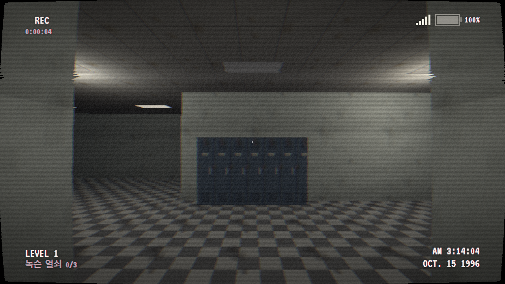
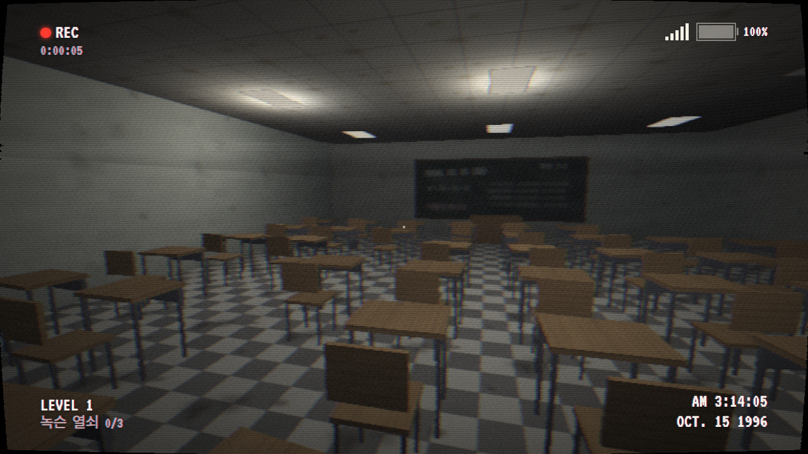
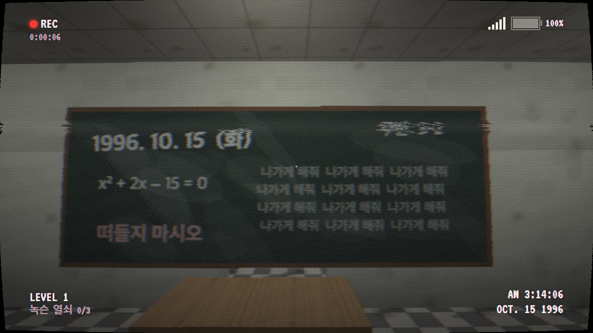
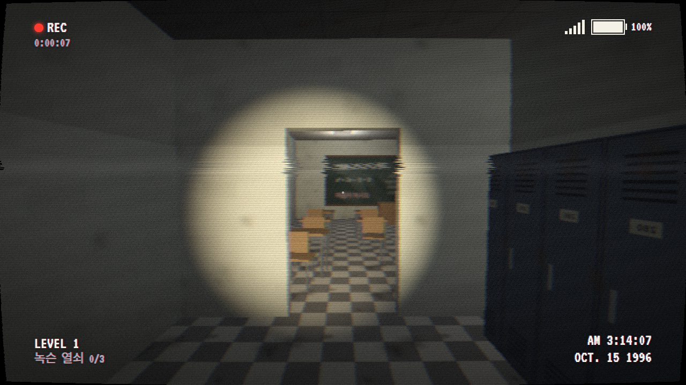
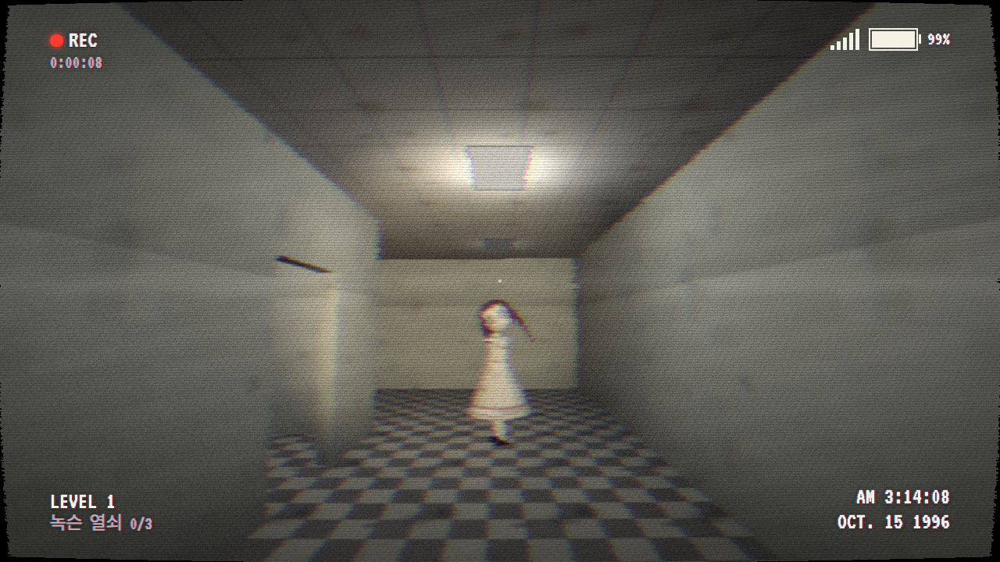
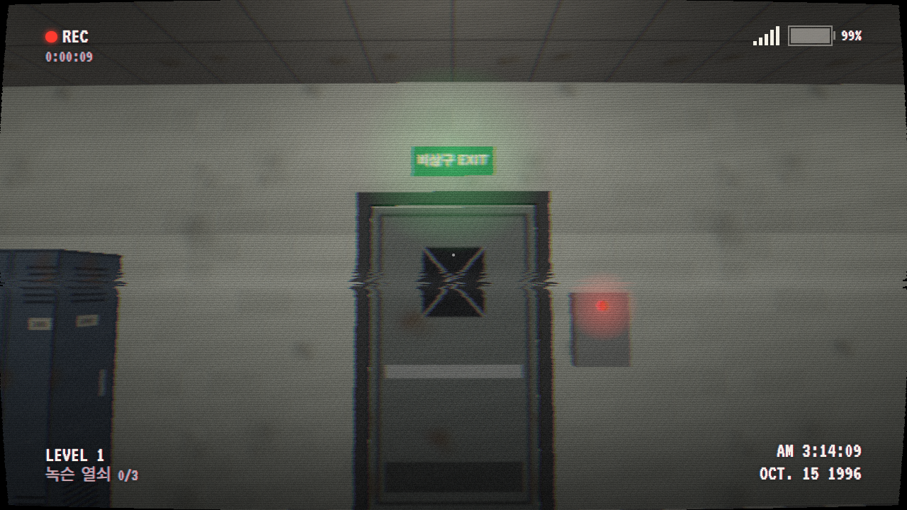
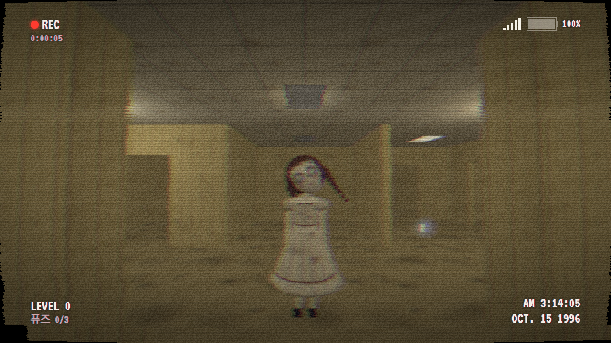
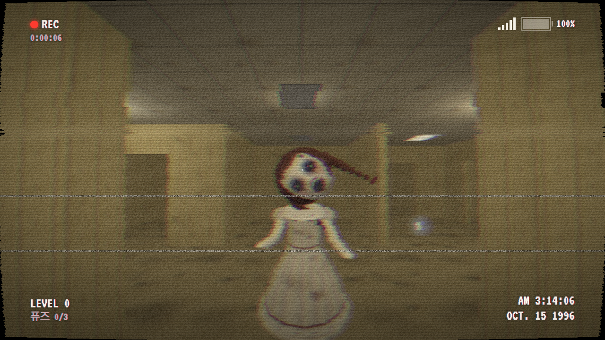
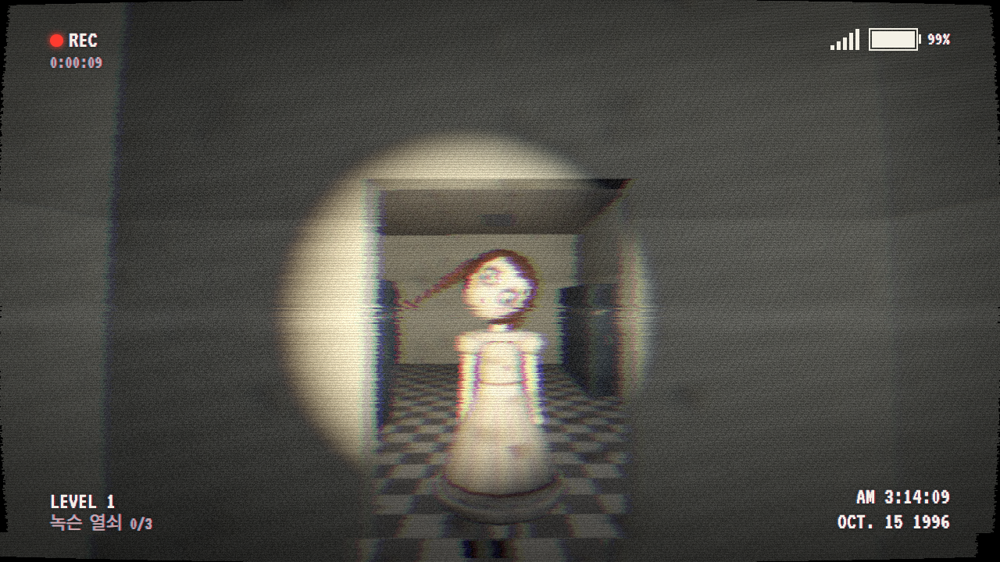
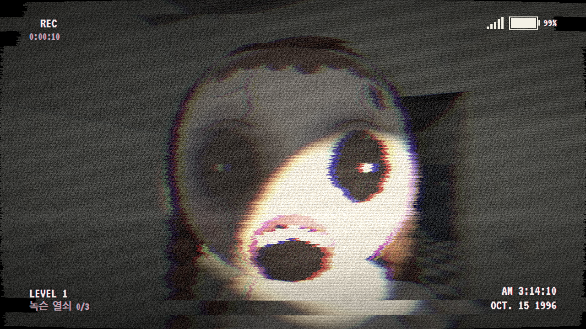

# NOCLIP — 웹 브라우저 백룸 공포게임

> **▶ 바로 플레이: https://noclip-swart.vercel.app** (데스크톱 브라우저 · 헤드폰 권장)

- **시작일**: 2026-10-15
- **상태**: ✅ 플레이 가능 (v0.1)
- **레퍼런스**: [The Classrooms](https://store.steampowered.com/app/2099110/The_Classrooms/) (Steam, 절차 생성 · 파운드 푸티지 · 리미널 스페이스 호러)
- **사용 라이브러리**: [three.js](https://github.com/mrdoob/three.js) `r160` (CDN, MIT)
- **저장소**: [MoonG25/noclip](https://github.com/MoonG25/noclip) · `main`에 푸시하면 Vercel에 자동 배포된다

## 왜 해보는가

The Classrooms는 1996년 VHS 테이프라는 설정 아래, 매번 다르게 생성되는 학교 복도와 교실을 헤매며 소리에 반응하는 엔티티를 피하는 게임이다.
이 감성을 **빌드 없이 브라우저에서 바로 돌아가는** 형태로 만들 수 있는지 확인하고 싶었다.
그래서 에셋 파일을 하나도 쓰지 않았다. 텍스처는 캔버스로 그리고 소리는 WebAudio로 합성했다.

## 무엇을 만들었나

1인칭 백룸 탐험 공포게임. 플레이 화면 전체가 1996년 캠코더로 녹화되는 테이프처럼 보인다.

| 레벨 | 분위기 | 목표 |
|---|---|---|
| **LEVEL 0 · 로비** | 노란 벽지, 젖은 카펫, 웅웅거리는 형광등, 기둥이 늘어선 넓은 방 | 퓨즈 3개 → 비상구 |
| **LEVEL 1 · 교실** | 어두운 복도, 사물함, 책상이 줄지어 선 교실, 칠판 낙서, 뒤틀린 종소리 | 녹슨 열쇠 3개 → 비상구 |

### 스크린샷 · LEVEL 1 교실

| | |
|---|---|
|  |  |
| 시작 지점 복도와 사물함 | 책상이 줄지어 선 교실 |
|  |  |
| 칠판 낙서 | 불 꺼진 복도를 손전등으로 비춘 모습 |
|  |  |
| 복도 끝에 서 있는 인형 | 잠긴 비상구 (빨간 불 = 열쇠 부족) |

### 엔티티 · 도자기 인형

| | |
|---|---|
|  |  |
| 고개를 꺾은 채 서 있다 | 들키면 입이 찢어지듯 벌어진다 |
|  |  |
| 손전등에 비친 모습 | 잡혔을 때 |

### 핵심 요소

- **절차 생성 맵**: 시드 기반 미로(DFS) → 방 만들기 → 추가 개구부로 순환 경로 → 연결성 보정. 매 판 다른 구조가 나온다.
- **엔티티 · 사람만 한 도자기 인형**: 금 간 얼굴, 유리눈, 볼터치, 땋은 머리, 빛바랜 레이스 드레스, 구체 관절. 초당 8~14프레임으로만 움직이는 스톱모션, 목이 꺾인 듯한 고개 각도, 항상 플레이어를 향하는 머리. 들키면 얼굴이 텅 빈 눈과 찢어진 입으로 바뀐다.
- **엔티티 AI**: 배회 → 소리 조사 → 시야에 들어오면 추격 → 놓치면 수색. 그것이 지나가는 근처의 형광등이 깜빡인다.
- **오르골**: 인형이 돌아다니는 동안 태엽이 풀려가는 오르골 소리가 3D 위치음으로 들린다. **오르골이 뚝 끊기고 킥킥거리는 소리가 나면 들킨 것이다.** 발소리는 도자기가 바닥에 부딪히는 딱딱한 소리.
- **소리 = 위치 노출**: 뛰면 17m, 걸으면 7m, 웅크리면 2m 안에서 들린다. 벽 너머로는 덜 들린다.
- **마이크 모드 (선택)**: 실제로 소리를 내면 게임 속 엔티티가 듣는다. The Classrooms의 음성 인식 요소를 가져왔다.
- **캠코더 HUD**: REC 표시, 1996년 날짜와 시각, 테이프 카운터, 배터리(손전등), 신호 막대(정신력).
- **VHS 셰이더**: 저해상도 렌더링, 색수차, 트래킹 노이즈, 스캔라인, 글리치 블록, 비네팅.
- **정신력**: 어둠 속이나 엔티티 근처에서 깎인다. 바닥나면 엔티티가 당신의 위치를 감지한다. 아몬드 워터를 마시면 회복된다.
- **쪽지**: 벽에 붙은 이전 탐사자의 기록. 레벨마다 4장.

## 실행 방법

ES 모듈을 쓰기 때문에 `file://`로는 열리지 않는다. 로컬 서버가 필요하다.

```bash
# 저장소 루트에서
python3 -m http.server 8765
# 브라우저에서 http://localhost:8765 열기
```

- 처음 열 때 three.js를 CDN에서 받아오므로 인터넷 연결이 필요하다.
- 데스크톱 Chrome, Edge, Firefox 권장. 마우스와 키보드가 필요하다.
- URL 파라미터
  - `?seed=1234` 특정 맵 고정
  - `?level=1` 교실 레벨부터 시작
  - `?test` 포인터 락 없이 실행하고 `window.__noclip`을 노출 (자동 테스트용)

### 조작

| 키 | 동작 |
|---|---|
| WASD | 이동 |
| 마우스 | 시점 |
| Shift | 달리기 (스태미나 소모, 소리 큼) |
| C | 웅크리기 (느리지만 조용함) |
| F | 손전등 (배터리 소모) |
| E | 줍기 · 쪽지 읽기 · 비상구 열기 |
| Esc | 일시정지 |

## 구조

```
index.html        HUD, 타이틀, 일시정지, 사망, 엔딩 화면
style.css
src/
  main.js         게임 루프, 상태 머신, 상호작용
  themes.js       레벨 설정 (새 레벨은 여기에 객체 하나 추가)
  level.js        맵 생성, 지오메트리, 충돌, 경로탐색(BFS), 시야 판정
  entity.js       도자기 인형 모델, 스톱모션 애니메이션, AI
  player.js       이동, 스태미나, 손전등, 헤드밥
  lights.js       형광등 깜빡임, 가까운 등에 PointLight 8개 배정
  audio.js        WebAudio 합성 사운드 (형광등, 발소리, 오르골, 킥킥거림, 심장박동, 점프스케어 등)
  vhs.js          캠코더 후처리 셰이더
  textures.js     캔버스로 그리는 텍스처 (벽지, 카펫, 칠판, 사물함, 인형 얼굴·드레스 등)
  props.js        아이템, 비상구, 책상
```

## 결과

- 잘 된 것:
  - 에셋 0개로 백룸 특유의 노란 리미널 공간과 교실 분위기가 꽤 그럴듯하게 나온다.
  - 헤드리스 Chrome에서 1280x720 기준 60fps를 유지했다.
  - 시드 80개(레벨당 40개)로 맵을 생성해 검증했다. 연결성, 아이템 배치, 출구 접근성 모두 문제없었다.
  - 레벨 0 클리어 → 레벨 1 → 엔딩까지 자동 테스트로 통과했다.
- 안 된 것 / 한계:
  - 사운드와 마우스 감도는 실제 헤드폰과 마우스로 직접 튜닝해야 한다. 자동 테스트로는 확인할 수 없다.
  - 엔티티는 경로를 따라 움직일 때 책상을 통과한다. 이상현상이라고 치기로 했다.
  - 모바일은 지원하지 않는다.
- 감상: The Classrooms의 핵심은 무서운 그래픽보다 "녹화 중"이라는 프레이밍과 소리다. VHS 셰이더와 형광등 웅웅거림만으로도 분위기의 절반이 만들어진다.

## 다음에 해볼 것

- [ ] LEVEL 2 · 풀룸 (물에 잠긴 수영장 복도, 발소리가 첨벙거림)
- [ ] 엔티티 종류 추가 (보고 있으면 멈추는 것, 소리만 따라오는 것)
- [ ] 캠코더 줌, 야간 모드(적외선 녹색 화면)
- [ ] 녹화 테이프를 실제 영상 파일로 저장 (MediaRecorder)
- [ ] 모바일 터치 조작
